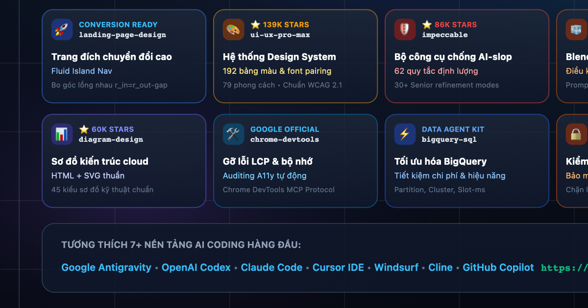

# Vie Agentic Skill (VAS)

**Thư viện kỹ năng cho trợ lý AI lập trình, có hướng dẫn sử dụng bằng tiếng Việt.**

VAS tập hợp **3.185 skill** thuộc **119 danh mục**, do [Huy Tran](https://github.com/huytran1120) tuyển chọn và duy trì. Bạn có thể tìm quy trình phù hợp với công việc, đọc nội dung rồi cài vào dự án đang dùng với Antigravity, Codex, Claude Code, Cursor, Windsurf, Cline hoặc GitHub Copilot CLI.

**[Mở thư viện skill](https://huytran1120.github.io/vie-agentic-skills/?lang=vi)** · [Xem toàn bộ danh mục](CATALOG.md) · [Báo lỗi hoặc đề xuất](https://github.com/huytran1120/vie-agentic-skills/issues)

Một **skill** là bộ hướng dẫn nghiệp vụ dành cho agent: khi nào áp dụng, cần thông tin gì, các bước thực hiện và cách kiểm tra kết quả. Nội dung chính nằm trong `SKILL.md`; một số skill có thêm mã hỗ trợ, biểu mẫu và tài liệu tham khảo. Cài skill giúp agent tiếp cận quy trình đó; các công cụ, tài khoản hoặc dịch vụ mà quy trình yêu cầu vẫn cần được thiết lập riêng.

## Nội dung

- [Bắt đầu từ website](#bat-dau)
- [Cài và quản lý bằng CLI](#cai-bang-cli)
- [Chọn agent và thư mục cài](#chon-agent)
- [Tìm skill theo công việc](#tim-skill)
- [Các bộ sưu tập chuyên ngành](#bo-suu-tap)
- [Câu hỏi thường gặp](#cau-hoi)
- [Đóng góp và chạy thử dự án](#dong-gop)
- [Nguồn và giấy phép](#nguon-va-giay-phep)

<a id="vietnamese"></a>
<a id="bat-dau"></a>
## Bắt đầu từ website

Đây là cách sử dụng khi bạn muốn cài một skill vào dự án mà không tải toàn bộ kho VAS.

1. Mở [thư viện tiếng Việt](https://huytran1120.github.io/vie-agentic-skills/?lang=vi).
2. Tìm theo tác vụ, công nghệ, tác giả hoặc nguồn; dùng bộ lọc danh mục để thu hẹp kết quả.
3. Mở một skill, đọc mô tả và yêu cầu sử dụng, rồi chọn agent đang dùng.
4. Bấm **Copy prompt** ở kết quả hoặc **Copy Agent Prompt** trong trang chi tiết.
5. Dán nội dung đã sao chép vào cuộc trò chuyện với agent trong **dự án cần cài**.

Prompt cung cấp mã skill, thư mục đích và bản kê tệp chính thức. Agent cần quyền truy cập mạng và ghi tệp để tải đủ nội dung, giữ cấu trúc thư mục và kiểm tra SHA-256. Nếu bản cài khác nội dung hoặc có xung đột, prompt yêu cầu agent hỏi trước khi thay thế.

Website chỉ sao chép hướng dẫn; thao tác cài đặt do agent thực hiện trên máy của bạn. Luồng này không tự chạy mã hỗ trợ, cài thêm công cụ hoặc kết nối dịch vụ. Muốn chọn thư mục tuyệt đối, cài toàn máy hoặc dùng liên kết đến kho nguồn, hãy dùng CLI bên dưới.

Sau khi cài, nạp lại danh sách skill nếu ứng dụng yêu cầu. Bạn có thể bắt đầu bằng yêu cầu:

```text
Đọc SKILL.md của skill code-review vừa cài và rà soát phần thay đổi hiện tại.
Nêu lỗi có thể tái hiện, vị trí trong mã nguồn và cách kiểm tra sau khi sửa.
```

<a id="cai-bang-cli"></a>
## Cài và quản lý bằng CLI

CLI là công cụ dòng lệnh để tìm, xem, cài và gỡ skill. Công cụ dùng thư viện chuẩn Python; sau khi có kho trên máy, các lệnh quản lý không cần tải gói từ bên ngoài. Từng skill có thể có yêu cầu công cụ riêng.

### 1. Tải kho VAS

Cần có Git và Python 3.9 trở lên. Các ví dụ dùng `python3`; dự án được kiểm thử tự động với Python 3.11. Trên Windows, nếu Python được gọi bằng `python`, hãy thay `python3` bằng `python` trong các lệnh dưới đây.

```bash
git clone https://github.com/huytran1120/vie-agentic-skills.git
cd vie-agentic-skills
python3 vas.py --help
```

Trên macOS hoặc Linux, có thể dùng `./vas` thay cho `python3 vas.py`.

### 2. Tìm và đọc trước khi cài

```bash
python3 vas.py search "code review"
python3 vas.py show code-review
```

Lệnh `show` hiển thị thông tin nguồn, giấy phép và xem trước 40 dòng đầu. Mở tệp `SKILL.md` tại đường dẫn được hiển thị để đọc toàn bộ hướng dẫn trước khi cài. Chọn vài skill liên quan trực tiếp đến công việc hiện tại để agent dễ sử dụng và bạn dễ quản lý.

### 3. Cài vào đúng dự án

Ví dụ cài `code-review` cho Codex trong một dự án khác với kho VAS:

```bash
python3 vas.py install code-review --target codex --mode copy --dest "/Projects/my-app/.codex/skills"
python3 vas.py status --target codex --dest "/Projects/my-app/.codex/skills"
```

**Thay `/Projects/my-app` bằng đường dẫn thật trên máy.** `--dest` là thư mục **chứa các skill**, không phải thư mục gốc dự án. Trong ví dụ này, nội dung được cài tại `/Projects/my-app/.codex/skills/code-review/`.

Nếu bỏ cả `--dest` và `--global`, CLI cài theo thư mục đang chạy lệnh. Chạy lệnh từ kho VAS sẽ cài vào thư mục agent bên trong chính kho VAS. Để cài cho dự án khác, dùng `--dest` như ví dụ trên hoặc gọi `vas.py` bằng đường dẫn tuyệt đối từ thư mục dự án đó.

### 4. Sử dụng và gỡ khi không còn cần

Mở dự án đích trong agent, nạp lại danh sách skill nếu cần, rồi yêu cầu agent đọc `SKILL.md` và thực hiện tác vụ. Nếu runbook yêu cầu runtime, MCP hoặc tài khoản, hãy thiết lập theo hướng dẫn của skill đó.

Gỡ bản cài bằng **cùng thư mục đích** đã dùng:

```bash
python3 vas.py uninstall code-review --target codex --dest "/Projects/my-app/.codex/skills"
```

### Chọn chế độ và phạm vi cài

| Lựa chọn | Cách hoạt động | Khi nên dùng |
| --- | --- | --- |
| `--mode copy` | Sao chép toàn bộ thư mục skill; bản cài độc lập với kho VAS | Muốn di chuyển hoặc xóa kho VAS sau khi cài |
| `--mode link` | Tạo liên kết tượng trưng đến skill trong kho VAS; đây là chế độ mặc định | Muốn bản cài phản ánh thay đổi trong kho nguồn trên máy |
| `--global` | Cài vào thư mục toàn máy của một agent | Muốn dùng cùng skill ở nhiều dự án |
| `--dest "đường-dẫn"` | Chỉ định trực tiếp thư mục chứa skill | Cài từ kho VAS sang một dự án cụ thể |

Với `link`, cần giữ nguyên vị trí kho VAS. Liên kết phản ánh thay đổi trong kho trên máy, không tự tải phiên bản mới từ GitHub. Với `copy`, cài lại cùng ID vào cùng đích để cập nhật; VAS có thể thay nội dung của bản cài do mình quản lý.

Ví dụ cài toàn máy cho Codex:

```bash
python3 vas.py install code-review --target codex --global --mode copy
python3 vas.py status --target codex --global
python3 vas.py uninstall code-review --target codex --global
```

Không kết hợp `--target all` với `--global`. `--target all` chọn bảy agent trong dự án hiện tại, còn `--all` chọn toàn bộ catalog. Nên chọn skill theo nhu cầu thay vì cài cả catalog.

CLI ghi thông tin quản lý vào `.vas-manifest.json`. Thư mục có sẵn chưa do VAS quản lý, bản kê hỏng hoặc tên thư mục đang thuộc skill khác sẽ bị từ chối và giữ nguyên. Xem phần [xử lý xung đột](#xu-ly-xung-dot) trước khi thay đổi các thư mục đó.

<a id="chon-agent"></a>
## Chọn agent và thư mục cài

Bảng sau là đường dẫn mà CLI VAS sử dụng. Thay giá trị của `--target` và thư mục trong `--dest` cho phù hợp với agent của bạn.

| Agent | Giá trị `--target` | Trong dự án | Toàn máy với `--global` |
| --- | --- | --- | --- |
| Google Antigravity | `antigravity` | `.agents/skills/` | `~/.gemini/antigravity/skills/` |
| OpenAI Codex | `codex` | `.codex/skills/` | `~/.codex/skills/` |
| Claude Code | `claude` | `.claude/skills/` | `~/.claude/skills/` |
| Cursor | `cursor` | `.cursor/skills/` | `~/.cursor/skills/` |
| Windsurf | `windsurf` | `.windsurf/skills/` | `~/.codeium/windsurf/skills/` |
| Cline / Roo Code | `cline` | `.cline/skills/` | `~/.cline/skills/` |
| GitHub Copilot CLI | `copilot` | `.github/skills/` | `~/.copilot/skills/` |

CLI còn có `--target workspace` cho `.agents/skills/` và `--target gemini` cho `.gemini/skills/`. Cách ứng dụng phát hiện và kích hoạt skill phụ thuộc agent, phiên bản và cấu hình đang dùng; nếu chưa thấy skill, kiểm tra đường dẫn rồi nạp lại ứng dụng.

Để cài cùng một skill cho cả bảy agent, chạy từ **thư mục dự án đích**, thay đường dẫn đến kho VAS bằng đường dẫn thật:

```bash
python3 /duong-dan/vie-agentic-skills/vas.py install code-review --target all --mode copy
```

<a id="tim-skill"></a>
## Tìm skill theo công việc

Tìm theo công việc bạn cần làm trước, sau đó đọc mô tả và yêu cầu của từng kết quả. Tên skill và từ khóa kỹ thuật thường bằng tiếng Anh; các từ khóa như `security`, `testing`, `react` hoặc tên tác giả giúp tìm chính xác hơn.

| Công việc | Skill để bắt đầu |
| --- | --- |
| Rà soát thay đổi mã nguồn | [`code-review`](skills/code-review/SKILL.md) |
| Xây dựng giao diện web | [`frontend-design`](skills/frontend-design/SKILL.md) |
| Kiểm thử ứng dụng web bằng Playwright | [`webapp-testing`](skills/webapp-testing/SKILL.md) |
| Kiểm tra bảo mật dự án dùng Cloudflare | [`cloudflare-security-audit`](skills/cloudflare-security-audit/SKILL.md) |
| Điều phối quy trình Blender | [`blender-skills/blender-director`](skills/blender-skills/blender-director/SKILL.md) |
| Xử lý tài liệu | [`pdf`](skills/pdf/SKILL.md), [`docx`](skills/docx/SKILL.md), [`pptx`](skills/pptx/SKILL.md), [`xlsx`](skills/xlsx/SKILL.md) |
| Làm việc với truy vấn BigQuery | [`bigquery-sql`](skills/bigquery-sql/SKILL.md) |
| Xử lý video và âm thanh với FFmpeg | [`ffmpeg-skill`](skills/ffmpeg-skill/SKILL.md) |

Một số danh mục để tra cứu:

| Chuyên môn | Mã danh mục | Số skill |
| --- | --- | ---: |
| Phát triển phần mềm | `development` | 230 |
| Bảo mật | `security` | 267 |
| Vận hành và triển khai | `devops` | 169 |
| Điện toán đám mây | `cloud` | 170 |
| Kiểm thử | `testing` | 51 |
| Trí tuệ nhân tạo và học máy | `ai-ml` | 136 |

```bash
python3 vas.py search security --limit 10
python3 vas.py search "Matt Pocock" --limit 40
python3 vas.py list --category testing --limit 10
python3 vas.py categories
python3 vas.py tags
```

Xem [CATALOG.md](CATALOG.md) để tra cứu toàn bộ danh mục. Với skill có tiền tố như `blender-skills/blender-director`, dùng **đầy đủ ID** khi tìm, cài và gỡ.

<details>
<summary>Xem hình minh họa một số nhóm skill</summary>



Các hình là minh họa phạm vi công việc; hãy đọc runbook của từng skill để biết yêu cầu và cách thực hiện.

</details>

<a id="bo-suu-tap"></a>
## Các bộ sưu tập chuyên ngành

Các hướng dẫn chi tiết được tách riêng để bạn chỉ mở phần cần dùng. Số lượng dưới đây là số skill, không tính chủ đề giao diện hoặc tệp tài nguyên đi kèm.

| Bộ sưu tập | Số skill | Nội dung và tài liệu |
| --- | ---: | --- |
| Blender | 94 | Dựng hình, vật liệu, hoạt họa và kết xuất; xem [hướng dẫn Blender](skills/blender-skills/README.md) |
| GameDev | 78 | Quy trình phát triển trò chơi; xem [hướng dẫn GameDev](docs/gamedev.md) |
| Android | 35 | Phát triển và kiểm thử Android; xem [hướng dẫn Android](docs/android.md) |
| Matt Pocock | 35 | Rà soát mã, đặc tả, chia tác vụ và quy trình làm việc; xem [nguồn và bản ghi nhập](data/mattpocock-skills.json) |
| Addy Osmani | 25 | Quy trình kỹ thuật phần mềm; tra theo `addyosmani/agent-skills` trên website hoặc CLI |
| YouTube | 11 | Kế hoạch, kịch bản và xuất bản; xem [hướng dẫn YouTube](skills/youtube-agent-skill/README.md) |
| Hallmark | 1 | Thiết kế website với 50 chủ đề; xem [hướng dẫn Hallmark](docs/hallmark.md) |
| TypeSafe | 1 | Tích hợp Jev để đánh giá dữ liệu và hỗ trợ quyết định trong ứng dụng; xem [hướng dẫn TypeSafe](docs/typesafe.md) |
| UI Unslop | 1 | Tinh chỉnh giao diện; ID `heydamir-unslop`, giấy phép CC-BY-4.0; xem [hướng dẫn UI Unslop](docs/unslop.md) |
| DaVinci Video Editor | 12 | Dựng video với DaVinci Resolve Studio; CC-BY-NC-4.0, giới hạn sử dụng phi thương mại; xem [hướng dẫn DaVinci](docs/video-editor.md) |
| editonny | 1 | Dựng video trên máy, phụ đề và cảnh chuyển động; xem [hướng dẫn editonny](docs/editonny.md) |

Các tài liệu kiểm tra kỹ thuật dùng chung nằm trong [references/](references/), gồm kiểm thử, bảo mật, hiệu năng, khả năng tiếp cận, vận hành và điều phối agent.

<a id="cau-hoi"></a>
## Câu hỏi thường gặp

### Đã cài nhưng agent chưa nhận skill?

Chạy `status` với cùng `--target`, `--dest` hoặc `--global` đã dùng khi cài. Kiểm tra thư mục đích có `SKILL.md`, nạp lại danh sách skill hoặc mở lại dự án. Có thể yêu cầu agent đọc trực tiếp tệp đó. Việc cài thư mục không tự cấu hình MCP, API hoặc công cụ bên ngoài.

### Dùng `link` trên Windows gặp lỗi quyền?

Dùng `--mode copy` nếu môi trường không cho tạo liên kết tượng trưng. Trên Windows, thay `/Projects/my-app` trong ví dụ bằng đường dẫn Windows thật và giữ dấu ngoặc kép nếu có khoảng trắng.

<a id="xu-ly-xung-dot"></a>
### CLI báo xung đột hoặc không cho ghi đè?

VAS giữ nguyên thư mục chưa được quản lý và bản kê không hợp lệ. Kiểm tra nội dung tại đích trước; sao lưu hoặc di chuyển thư mục bạn tự tạo nếu muốn thay bằng bản VAS. Nếu hai ID cùng dùng một tên thư mục, gỡ đúng skill đang sở hữu tên đó trước khi cài skill còn lại. Với `.vas-manifest.json` hỏng, khôi phục bản kê từ bản sao lưu trước khi tiếp tục quản lý bằng CLI.

### Cập nhật skill bằng cách nào?

Cập nhật kho VAS bằng Git khi không có thay đổi cục bộ cần giữ:

```bash
git pull --ff-only
```

Bản cài `link` sẽ đọc nội dung từ kho vừa cập nhật. Bản cài `copy` cần chạy lại lệnh `install` với cùng ID và cùng đích. Nếu đã tự chỉnh bản cài, lưu lại thay đổi trước khi cài lại.

### Skill và tài liệu nguồn có được dịch hết sang tiếng Việt không?

README này là hướng dẫn sử dụng thống nhất bằng tiếng Việt. Tên công cụ, ID, lệnh và nội dung gốc của các skill được giữ để tra cứu, thực thi và bảo toàn nguồn. Bạn có thể yêu cầu agent giải thích quy trình và trả lời bằng tiếng Việt.

<a id="dong-gop"></a>
## Đóng góp và chạy thử dự án

Để báo lỗi, mở [GitHub Issues](https://github.com/huytran1120/vie-agentic-skills/issues) và ghi rõ ID skill, agent, lệnh đã chạy, hệ điều hành cùng kết quả mong đợi. Khi đề xuất skill mới, kèm nguồn và giấy phép.

Cấu trúc một skill:

```text
skills/<skill-id>/
├── SKILL.md          # Tên, mô tả, danh mục, thẻ và hướng dẫn thực hiện
├── scripts/          # Mã hỗ trợ, nếu có
├── examples/         # Ví dụ sử dụng, nếu có
└── references/       # Tài liệu tham khảo, nếu có
```

Giữ nguyên giấy phép, thông tin tác giả và tài nguyên cần thiết. Sau khi thay đổi metadata hoặc thêm skill, dựng lại chỉ mục:

```bash
python3 vas.py sync
```

Xem giao diện trên máy bằng cách phục vụ **thư mục gốc dự án**:

```bash
python3 -m http.server 8765 --bind 127.0.0.1
```

Mở [bản xem trước](http://127.0.0.1:8765/docs/). Phục vụ từ thư mục gốc giúp các liên kết tới `skills/` hoạt động đúng.

Các lệnh kiểm tra dự án; phần giao diện cần Node.js và Chrome/Chromium:

```bash
python3 -B -m unittest discover -s tests -p 'test_*.py'
node --test tests/*.test.cjs
python3 scripts/build_pages.py
```

Bản dựng website nằm tại `_site/`. [Quy trình GitHub Pages](.github/workflows/deploy-pages.yml) triển khai website từ nhánh `main` sau các bước kiểm tra.

<a id="nguon-va-giay-phep"></a>
## Nguồn và giấy phép

- **Người tuyển chọn và duy trì:** [Huy Tran](https://github.com/huytran1120).
- **Kho dự án:** [huytran1120/vie-agentic-skills](https://github.com/huytran1120/vie-agentic-skills).
- **Nguồn tổng hợp:** xem [ghi nhận tác giả và nguồn](data/source-credits.json), [bản ghi snapshot](data/distribution-snapshot.json) và bản ghi nhập của từng bộ sưu tập.
- **Công cụ VAS:** phát hành theo [giấy phép MIT](LICENSE).
- **Skill và tài nguyên nhập từ nguồn khác:** giữ giấy phép, tác giả và thông báo bản quyền riêng. Kiểm tra `LICENSE`, `NOTICE` và hướng dẫn của skill trước khi sử dụng hoặc phân phối lại; một số bộ có điều kiện khác MIT.

Kho được phát triển từ bản tổng hợp [vietnam-agentic-skills](https://github.com/huytran1120/vietnam-agentic-skills), với snapshot gốc `8dd77cd14fea84ad3a9f51573461a227ae06082e`. Các runbook `pdf`, `docx`, `pptx`, `xlsx` trong VAS là bản thay thế được viết độc lập theo MIT.
