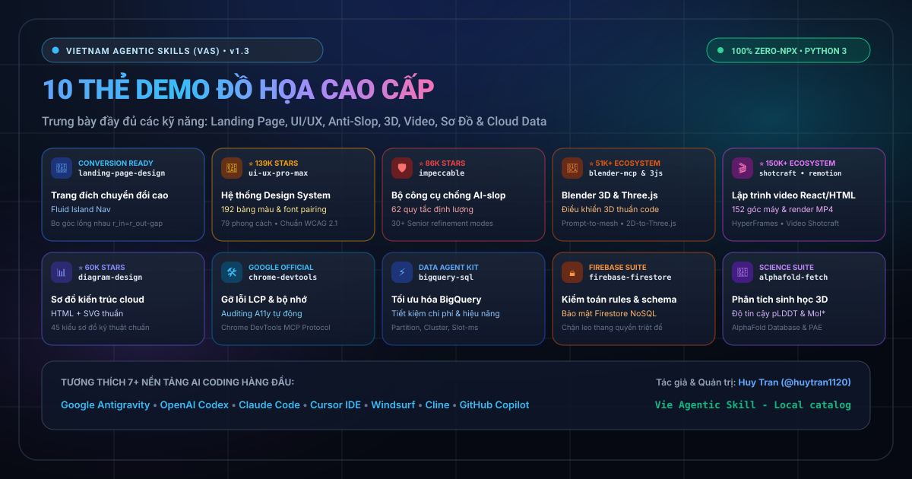
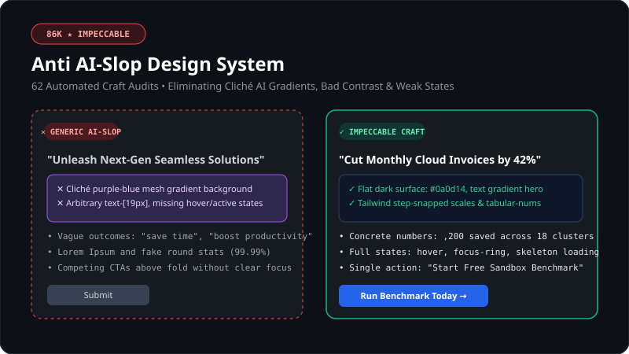
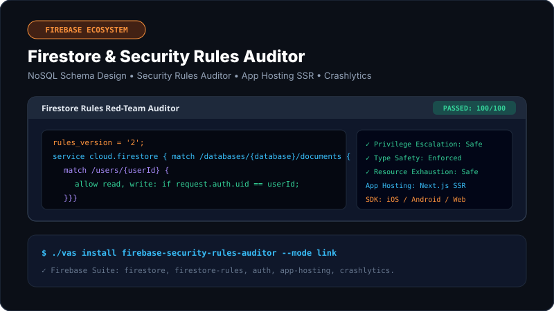

# 🇻🇳 Vie Agentic Skill (VAS) - English Edition

<p align="center">
  <a href="README.md#vietnamese"><b>🇻🇳 Tiếng Việt (Bilingual README)</b></a> &nbsp;|&nbsp;
  <a href="README_EN.md"><b>🇬🇧 English Edition</b></a>
</p>

<p align="center">
  <b>Universal, Modular Agentic Skills Catalog for AI Coding Agents</b><br>
  <i>Empowering Google Antigravity, OpenAI Codex, Claude Code, Cursor, Windsurf, Cline & GitHub Copilot CLI</i>
</p>

<p align="center">
  <a href="https://github.com/huytran1120/vie-agentic-skills"></a>
  <a href="https://github.com/huytran1120/vie-agentic-skills"></a>
  <a href="https://github.com/huytran1120/vie-agentic-skills"></a>
  <a href="https://github.com/huytran1120/vie-agentic-skills"></a>
  <a href="https://github.com/huytran1120/vie-agentic-skills"></a>
  <a href="https://github.com/huytran1120/vie-agentic-skills"></a>
</p>
<p align="center">
  <a href="https://huytran1120.github.io/vie-agentic-skills/"></a>
  <a href="CATALOG.md"></a>
  <a href="vas.py"></a>
  <a href="https://github.com/huytran1120"></a>
  <a href="LICENSE"></a>
</p>

> 🌐 **Web Explorer / Live Interactive Catalog**: [GitHub Pages](https://huytran1120.github.io/vie-agentic-skills/) · [Local preview](http://127.0.0.1:8765/docs/)  
> 🎨 **New Feature Suite**: Integrated the complete **94 Blender Studio skills** ([arjun988/blender-skills](https://github.com/arjun988/blender-skills)) for 3D modeling, texturing, animation & pipeline! See [Blender Studio Suite](#blender-studio).

The catalog-first website supports keyword/author/source search, category filters, agent selection, and inline install commands. Counts come directly from the actual catalog; no download or rating figures are fabricated. The website copies commands, not installs software on your machine.  
* **Local preview**: `python3 -m http.server 8765 --bind 127.0.0.1` and open `http://127.0.0.1:8765/docs/`.  
* **UI logic tests**: `node --test tests/pages.test.cjs`.  
* **Layout regressions**: `python3 -B -m unittest discover -s tests -p 'test_pages_layout.py'` or open `http://127.0.0.1:8765/tests/pages-layout.html`.  
* **Automated deployment**: GitHub Pages automatically deploys from `main` via `.github/workflows/deploy-pages.yml` (or build manually with `python3 scripts/build_pages.py` staging into `_site/`).

---

### 📌 Table of Contents
- [1. Overview](#1-overview)
- [2. Multi-Agent Compatibility](#2-multi-agent-compatibility)
- [3. Why Vie Agentic Skill?](#3-why-vie-agentic-skill)
- [4. Quickstart](#4-quickstart)
- [5. Agent-Specific Setup Guides](#5-agent-specific-setup-guides)
- [6. CLI Reference (`./vas`)](#6-cli-reference-vas)
- [7. Open Skill Specification (`SKILL.md`)](#7-open-skill-specification-skillmd)
- [8. Senior Engineering SDLC & 25 Addy Osmani Skills](#8-senior-engineering-sdlc--25-addy-osmani-skills)
- [9. 7 Technical Checklists & Reviewer Personas](#9-7-technical-checklists--reviewer-personas)
- [10. Honest Comparison Matrix (How VAS Compares)](#10-honest-comparison-matrix-how-vas-compares)
- [11. Featured & Viral Skills Showcase (Top 20)](#11-featured--viral-skills-showcase-top-20)
- [12. Frequently Asked Questions (FAQ)](#12-frequently-asked-questions-faq)
- [13. Author & License](#13-author--license)

---

### 1. Overview

**Vie Agentic Skill (VAS)** is an open-source project authored, curated, and maintained by **Huy Tran** ([@huytran1120](https://github.com/huytran1120)) with the mission to **aggregate, curate, and standardize the world's best agentic skills** for modern AI coding assistants.

Rather than leaving skills fragmented across different tools, isolated plugins, or proprietary repositories, VAS consolidates **3,058+ production-grade playbooks (`SKILL.md`)** across **119 specialized categories** into a unified ecosystem adhering to the **Open Agent Skills specification ([agentskills.io](https://agentskills.io/))**. It brings together the finest engineering runbooks from premier open-source contributors and industry organizations worldwide—including Addy Osmani, Cloudflare, Matt Pocock, Blender Studio, Google Devs, and Open Agent Skills.

Instead of treating your AI coding assistant as an entry-level intern that generates shallow answers, VAS equips agents with Senior-grade playbooks: deep diagnostic checklists, security hardening rules, performance formulas, and deterministic execution scripts.

---

### 2. Multi-Agent Compatibility

VAS installs skills into native target directories across all leading AI coding assistants with a single command:

| AI Agent / IDE | Target Directory | Install Command |
| :--- | :--- | :--- |
| **Google Antigravity** | `.agents/skills/` or `~/.gemini/antigravity/skills/` | `./vas install <skill> --target antigravity` |
| **OpenAI Codex / OpenCode** | `.codex/skills/` or `.agents/skills/` | `./vas install <skill> --target codex` |
| **Claude Code** | `.claude/skills/` or `~/.claude/skills/` | `./vas install <skill> --target claude` |
| **Cursor IDE** | `.cursor/skills/` | `./vas install <skill> --target cursor` |
| **Windsurf (Codeium)** | `.windsurf/skills/` | `./vas install <skill> --target windsurf` |
| **Cline / Roo Code** | `.cline/skills/` | `./vas install <skill> --target cline` |
| **GitHub Copilot CLI** | `.github/skills/` | `./vas install <skill> --target copilot` |
| **ALL AGENTS AT ONCE** | Installs into all target folders above | `./vas install <skill> --target all` |

---

### 3. Why Vie Agentic Skill?

| Feature | Legacy NPX Solutions | Vie Agentic Skill (VAS) |
| :--- | :--- | :--- |
| **Runtime Requirements** | Requires Node.js & remote `npx` execution | **Native Python 3 CLI (`./vas`)** with standard library only |
| **Network Reliance** | Requires internet connectivity on every run | **100% Offline & Zero Dependencies** |
| **CLI Latency** | 3s - 15s per invocation | **< 0.05 seconds** (instantaneous) |
| **Agent Ecosystem** | Limited or manual copy-pasting | **Native support for 7+ AI Coding Agents** |
| **Installation Engine** | Manual file copying | **Symlink (`--mode link`) & Atomic Copy** with automatic rollbacks |
| **Context Window Preservation** | Prone to context bloat | **Strict Progressive Disclosure** (saving up to 99% of prompt tokens) |

---

### 4. Quickstart

#### Option 1: Copy Agent Prompt — no repository clone

Open the [skill library](https://huytran1120.github.io/vie-agentic-skills/?lang=en),
find a skill, choose your agent, and click **Copy prompt** in the results or
**Copy Agent Prompt** in its details. Paste it into your agent chat in the open
project. The prompt includes the correct ID, agent folder and official manifest.

Your agent downloads the **complete skill**, including `SKILL.md`, scripts,
templates, references, licenses and assets, checking SHA-256 at one VAS snapshot.
Matching installations are skipped; differing files or another skill using the
same folder require confirmation, never silent replacement. This route does not
require cloning VAS, running `./vas` or installing Python.

Example for Cursor and a YouTube skill:

```text
Install "youtube-agent-skill/yt-script" into this project for Cursor at
".cursor/skills/yt-script/". Read the official manifest:
https://huytran1120.github.io/vie-agentic-skills/install-manifests/youtube-agent-skill/yt-script.json
Check the skill identity and available = true; download every listed file,
preserve its tree and verify SHA-256 before completing. Do not clone VAS, follow
symlinks or write outside this project. Skip matching installations; ask before
overwriting differing contents or an invalid receipt. Record receipt in
.vas-manifest.json in the agent skills folder, preserving other entries.
Read SKILL.md and report its path and missing prerequisites. Do not run scripts,
install dependencies or connect services automatically; stop on download/hash errors.
```

The agent needs network and file access. Individual runbooks may need additional
runtimes/MCP or an application skill reload. The website only copies instructions;
it does not install software. Global/link/absolute-path settings apply only to the
CLI below. Selecting `all` in chat installation means the seven agent folders in
the **current project**, not user-wide installation.

#### Option 2: CLI — offline, linked/copied and multi-skill management

```bash
# Step 1: Clone or enter the project directory
git clone https://github.com/huytran1120/vie-agentic-skills.git
cd vie-agentic-skills
chmod +x vas vas.py

# Step 2: Search for skills
./vas search docker-expert
./vas list --category security --limit 10
./vas categories

# Step 3: Install for your AI coding assistant
./vas install ui-ux-pro-max --target codex
./vas install docker-expert --target antigravity
./vas install fastapi-pro --target claude
./vas install react-component-performance --target cursor

# Install for ALL agents in your repository at once:
./vas install ui-ux-pro-max 007 pdf --target all
```
*(Smart alias system included: invoking `docker-security`, `fastapi-best-practices`, `react-performance`, or `nextjs-perf` will automatically map to the canonical skill).*

**Choose the destination explicitly:** without `--dest` or `--global`, the CLI
installs into the agent directory under the current working directory. It does
not locate another project automatically. On the website, open a skill and select
an agent and either a project or user-wide installation. Install, status and
uninstall commands share the same destination. For a separate project, run:

```bash
./vas install code-review --target codex --mode link --dest "/Projects/my-app/.codex/skills"
./vas status --target codex --dest "/Projects/my-app/.codex/skills"
./vas uninstall code-review --target codex --dest "/Projects/my-app/.codex/skills"
```

Replace `/Projects/my-app` with your actual project path. Use `--global` instead
of `--dest` for one agent across your user account; do not combine it with
`--target all`. Link mode requires keeping the VAS checkout in place; copy mode
creates an independent snapshot that must be reinstalled to update. Open your
project in the agent, reload its skill list if necessary, and ask it to read the
installed runbook before applying it. The website provides matching status and
uninstall commands and a sample prompt, including for namespaced Blender skills.

---

#### Hallmark: frontend design on request

[Open Hallmark in the catalog](https://huytran1120.github.io/vie-agentic-skills/?lang=en&skill=hallmark),
choose an agent and use **Copy Agent Prompt** to install all 182 files without
cloning. Hallmark is **one skill**, with 50 themes, references, previews, scripts
and its MIT notice; installation never redesigns a page or runs helpers.

From your VAS checkout, replace `/Projects/my-app` with your actual project:

```bash
./vas install hallmark --target cursor --mode copy --dest "/Projects/my-app/.cursor/skills"
./vas status --target cursor --dest "/Projects/my-app/.cursor/skills"
./vas uninstall hallmark --target cursor --dest "/Projects/my-app/.cursor/skills"
```

Use `--mode link` for symlinks, retaining the VAS checkout. Reading needs no Node;
helpers require Node.js 18+, and rendered checks need separate Chrome/Puppeteer.
Together AI generation is optional and may incur costs; photo licenses and
credits remain separate from MIT. See the [Hallmark VI/EN guide](docs/hallmark.md)
for every agent destination and complete prerequisites.

#### TypeSafe: Jev/System One integrations

[Open TypeSafe in the catalog](https://huytran1120.github.io/vie-agentic-skills/?lang=en&skill=typesafe-ai),
choose an agent and use **Copy Agent Prompt** to install `SKILL.md` and `LICENSE`
without cloning. From a VAS checkout, replace `/Projects/my-app` with your project:

```bash
./vas install typesafe-ai --target cursor --mode copy --dest "/Projects/my-app/.cursor/skills"
./vas status --target cursor --dest "/Projects/my-app/.cursor/skills"
./vas uninstall typesafe-ai --target cursor --dest "/Projects/my-app/.cursor/skills"
```

Use `--mode link` for symlinks, retaining the VAS checkout. The skill is MIT;
actual API calls need TypeSafe access and a server-side `TYPESAFE_API_KEY`.
Installation never installs an SDK, reads keys or sends data. Live probes need
permission, data disclosure and an agreed budget. See the [TypeSafe VI/EN guide](docs/typesafe.md)
for every agent destination and complete prerequisites.

### 5. Agent-Specific Setup Guides

- **Google Antigravity**: Discovered automatically through `.agents/skills/` or globally at `~/.gemini/antigravity/skills/`:
  ```bash
  ./vas install <skill_id> --target antigravity --mode link
  ./vas install <skill_id> --target global
  ```
- **OpenAI Codex / OpenCode**: Excels at direct code reasoning and command execution:
  ```bash
  ./vas install <skill_id> --target codex --mode link
  ```
  *Sample prompt for Codex:*
  > *"Inspect the runbook at `.codex/skills/<skill_id>/SKILL.md` and execute the security audit workflow for this workspace."*
- **Claude Code**: Reads skills from `.claude/skills/` or user home `~/.claude/skills/`:
  ```bash
  ./vas install <skill_id> --target claude --mode link
  ```
- **Cursor IDE**: Links to `.cursor/skills/` and integrates with `.cursorrules` or `@.cursor/skills/<skill_id>` in Composer:
  ```bash
  ./vas install <skill_id> --target cursor --mode link
  ```
- **Windsurf (Codeium)**: Loads workflows seamlessly from `.windsurf/skills/`:
  ```bash
  ./vas install <skill_id> --target windsurf --mode link
  ```
- **Cline / Roo Code**:
  ```bash
  ./vas install <skill_id> --target cline --mode link
  ```
- **GitHub Copilot CLI**: Integrates test & CI/CD skills under `.github/skills/`:
  ```bash
  ./vas install <skill_id> --target copilot --mode link
  ```

---

### 6. CLI Reference (`./vas`)

```bash
# 1. Search skills by keyword
./vas search kubernetes
./vas search "react performance" --limit 15

# 2. List skills with optional filters
./vas list --category security
./vas list --tag python --limit 20

# 3. Inspect metadata and preview Runbook
./vas show ui-ux-pro-max
./vas show docker-expert

# 4. Install skills
./vas install ui-ux-pro-max 007 --target codex
./vas install --category devops --target claude
./vas install --category security --target all

# 5. Uninstall skills
./vas uninstall 007 --target codex
./vas uninstall docker-expert --target all

# 6. Check installed skills status
./vas status --target codex
./vas status --target antigravity

# 7. Initialize workspace & rebuild index
./vas init
./vas sync
./vas guide
```

---

### 7. Open Skill Specification (`SKILL.md`)

Every skill within `skills/<skill_name>/` follows the vendor-neutral Open Agent Skills format:

```text
skills/<skill_name>/
├── SKILL.md          # [Required] YAML Frontmatter + Step-by-step Runbook
├── scripts/          # [Optional] Automation scripts (Python, Bash, JS)
├── examples/         # [Optional] Sample configs, input/output fixtures
└── references/       # [Optional] In-depth technical guides & checklists
```

```markdown
---
name: docker-expert
category: devops
tags: [docker, security, hardening, containers]
risk: safe
description: >-
  Use this skill when auditing Dockerfile or container configurations
  against security vulnerabilities, root execution, and secret leaks.
---

# Docker Security Hardening Runbook

## Instructions
1. Run static analysis: `scripts/analyze.sh`
2. Verify base image tags and non-root USER directive.
3. Review exposed ports and multi-stage build patterns.
```

---

### 8. Senior Engineering SDLC & 25 Addy Osmani Skills

By default, AI coding agents follow the path of least resistance: jumping directly into code without a specification, bypassing test-driven development, skipping security or performance threat modeling, and self-rationalizing that *"it seems right"*.

Inspired by and directly synchronized with the official **v0.6.13 release of Addy Osmani's agent skills** ([addyosmani/agent-skills](https://github.com/addyosmani/agent-skills) & [skills.addy.ie](https://skills.addy.ie/)), VAS integrates all **25 production-grade skills** mapped 1:1 across **6 phases of the software development lifecycle (SDLC)**:

```text
   DEFINE           PLAN            BUILD           VERIFY          REVIEW           SHIP
  ┌────────┐      ┌────────┐      ┌────────┐      ┌────────┐      ┌────────┐      ┌────────┐
  │  Idea  │ ───▶ │  Spec  │ ───▶ │  Code  │ ───▶ │  Test  │ ───▶ │   QA   │ ───▶ │   Go   │
  │ Refine │      │  PRD   │      │  Impl  │      │ Debug  │      │  Gate  │      │  Live  │
  └────────┘      └────────┘      └────────┘      └────────┘      └────────┘      └────────┘
   /spec           /plan           /build          /test          /review          /ship
```

#### 🛡️ The 4 Pillars of Senior Engineering Discipline
1. **Process, not prose**: Skills are actionable execution workflows with discrete steps, checkpoints, and strict exit criteria—not generic prompt advice.
2. **Anti-rationalization**: Every skill includes a *Common Rationalizations* table dismantling typical agent excuses (*"I'll write tests later"*, *"This is too trivial for security review"*), paired with actionable *Red Flags*.
3. **Verification is non-negotiable**: Agents must prove claims with reproducible evidence (passing test suites, runtime logs, DOM inspection, heap snapshots). "Seems right" is never accepted.
4. **Progressive disclosure**: `SKILL.md` serves as a lightweight entry point (< 150 prompt tokens initially). Supplementary in-depth guides load strictly on demand.

#### 📋 Complete Catalog of 25 Addy Osmani Skills by Phase

##### 🧭 Meta - Workflow Routing
| Skill | Core Capability | Trigger Condition |
| :--- | :--- | :--- |
| [`using-agent-skills`](skills/using-agent-skills/SKILL.md) | Maps incoming work to the appropriate skill workflow and defines shared operating boundaries | Starting a session or deciding which workflow applies |

##### 🎯 1. Define - Clarify What to Build
| Skill | Core Capability | Trigger Condition |
| :--- | :--- | :--- |
| [`interview-me`](skills/interview-me/SKILL.md) | Interrogates requirements one question at a time until reaching ~95% confidence on user intent | Requirements are ambiguous or user invokes "interview me" / "grill me" |
| [`idea-refine`](skills/idea-refine/SKILL.md) | Structured divergent/convergent thinking transforming raw ideas into concrete technical proposals | Exploring or scoping a rough early concept |
| [`spec-driven-development`](skills/spec-driven-development/SKILL.md) | Authors detailed PRDs covering objectives, CLI commands, architecture, code style, and testing gates before code | Starting a greenfield project, new feature, or major refactor |
| [`constraint-driven-development`](skills/constraint-driven-development/SKILL.md) | Establishes an enforceable quality bar in `CONSTRAINTS.md`, preventing agents from lowering thresholds | Team standards lack enforcement or an agent writes excessive unchecked code |

##### 🗺️ 2. Plan - Deconstruct & Sequence
| Skill | Core Capability | Trigger Condition |
| :--- | :--- | :--- |
| [`planning-and-task-breakdown`](skills/planning-and-task-breakdown/SKILL.md) | Decomposes specs into atomic, testable units with explicit acceptance criteria and topological ordering | A spec exists and needs implementation-ready task slices |

##### 🔨 3. Build - Implement with Rigor
| Skill | Core Capability | Trigger Condition |
| :--- | :--- | :--- |
| [`incremental-implementation`](skills/incremental-implementation/SKILL.md) | Delivers thin vertical slices: Implement → Test → Verify → Commit. Features safe defaults & rollback safety | Any code change touching more than one file |
| [`test-driven-development`](skills/test-driven-development/SKILL.md) | Red-Green-Refactor, 80/15/5 test pyramid, DAMP over DRY, Beyonce Rule, runtime browser verification | Writing new logic, fixing bugs, or changing system behavior |
| [`context-engineering`](skills/context-engineering/SKILL.md) | Feeds agents optimal context: rules configuration, context packing, MCP tool scoping | Starting a session, context switching, or when response quality degrades |
| [`source-driven-development`](skills/source-driven-development/SKILL.md) | Anchors framework decisions in official upstream documentation, citing sources and flagging deprecated APIs | High-correctness implementations requiring verified modern patterns |
| [`doubt-driven-development`](skills/doubt-driven-development/SKILL.md) | Fresh-context adversarial review of high-stakes decisions: CLAIM → EXTRACT → DOUBT → RECONCILE → STOP | High-risk changes (production, auth, finance), or unfamiliar codebases |
| [`frontend-ui-engineering`](skills/frontend-ui-engineering/SKILL.md) | Component architecture, state machines, responsive typography, and WCAG 2.1 AA accessibility | Designing or implementing client-facing web interfaces |
| [`api-and-interface-design`](skills/api-and-interface-design/SKILL.md) | Contract-first API design, Hyrum's Law, One-Version Rule, robust error semantics, input boundary validation | Authoring public APIs, microservice contracts, or module boundaries |

##### 🔍 4. Verify - Prove Correctness
| Skill | Core Capability | Trigger Condition |
| :--- | :--- | :--- |
| [`browser-testing-with-devtools`](skills/browser-testing-with-devtools/SKILL.md) | Leverages Chrome DevTools MCP for live runtime telemetry: DOM tree, console logs, network waterfalls, profiling | Building or troubleshooting browser-executed applications |
| [`debugging-and-error-recovery`](skills/debugging-and-error-recovery/SKILL.md) | 5-step triage: Reproduce → Localize → Reduce → Fix → Guard. Stop-the-line protocol and safe fallbacks | Failing test suites, broken builds, or unexpected runtime faults |

##### ⚖️ 5. Review - Pre-Merge Quality Gates
| Skill | Core Capability | Trigger Condition |
| :--- | :--- | :--- |
| [`code-review-and-quality`](skills/code-review-and-quality/SKILL.md) | Multi-axis review, ~100-line change sizing, explicit severity labels (Nit/Optional/FYI), review speed norms | Prior to merging any Pull Request |
| [`code-simplification`](skills/code-simplification/SKILL.md) | Chesterton's Fence, Rule of 500, dead code removal, minimizing cognitive complexity while preserving behavior | Functional code that suffers from excessive indirection or bloat |
| [`security-and-hardening`](skills/security-and-hardening/SKILL.md) | OWASP Top 10 mitigation, secrets hygiene, dependency supply-chain auditing, 3-tier trust boundary model | Handling untrusted input, user authentication, storage, or external APIs |
| [`performance-optimization`](skills/performance-optimization/SKILL.md) | Measurement-driven performance: Core Web Vitals (LCP, INP, CLS), CPU/RAM profiling, bundle budgeting | Strict performance SLAs exist or regression is suspected |

##### 🚀 6. Ship - Deploy with High Confidence
| Skill | Core Capability | Trigger Condition |
| :--- | :--- | :--- |
| [`git-workflow-and-versioning`](skills/git-workflow-and-versioning/SKILL.md) | Trunk-based development, atomic commits, and the commit-as-save-point pattern | Making any code modification in version control |
| [`ci-cd-and-automation`](skills/ci-cd-and-automation/SKILL.md) | Shift Left testing, Faster is Safer principle, quality gate pipelines, failure feedback loops | Establishing or optimizing automated build and deployment pipelines |
| [`deprecation-and-migration`](skills/deprecation-and-migration/SKILL.md) | Treating code as a liability, sunsetting zombie code, managing structured data & user migration paths | Sunsetting legacy services, deprecating endpoints, or refactoring schemas |
| [`documentation-and-adrs`](skills/documentation-and-adrs/SKILL.md) | Architecture Decision Records (ADRs), API references, documenting the *Why* behind engineering choices | Making architectural choices, public interface changes, or shipping milestones |
| [`observability-and-instrumentation`](skills/observability-and-instrumentation/SKILL.md) | Structured JSON logging, RED/USE metrics, OpenTelemetry distributed tracing, symptom-based alerting | Instrumenting telemetry or preparing services for production operations |
| [`shipping-and-launch`](skills/shipping-and-launch/SKILL.md) | Pre-flight checklists, staged canary rollouts, instant rollback procedures, active monitoring watch | Pre-release production deployments |

```bash
# Install the entire Addy Osmani Engineering Suite into your workspace:
./vas install test-driven-development debugging-and-error-recovery security-and-hardening performance-optimization code-review-and-quality --target all
```

---

### 9. 7 Technical Checklists & Reviewer Personas

#### 📚 Enterprise-Grade Reference Checklists (`references/`)
VAS skills dynamically load 7 comprehensive technical reference checklists housed in `references/`:

| Reference Guide | Subject Matter |
| :--- | :--- |
| [`references/definition-of-done.md`](references/definition-of-done.md) | Global Definition of Done (DoD) contract that every PR and task slice must satisfy |
| [`references/testing-patterns.md`](references/testing-patterns.md) | Production test layouts, naming semantics, mocking boundaries, React/API/E2E patterns, and anti-patterns |
| [`references/security-checklist.md`](references/security-checklist.md) | Pre-commit sanity checks, authz/authn, CSP headers, CORS policies, OWASP Top 10 mitigations |
| [`references/performance-checklist.md`](references/performance-checklist.md) | Core Web Vitals thresholds, frontend/backend optimization checklists, quantitative profiling commands |
| [`references/accessibility-checklist.md`](references/accessibility-checklist.md) | Keyboard navigation, screen reader compatibility, color contrast ratios, WCAG 2.1 AA ARIA rules |
| [`references/observability-checklist.md`](references/observability-checklist.md) | 2 AM on-call operational checks, structured logging standards, RED/USE metrics, distributed traces |
| [`references/orchestration-patterns.md`](references/orchestration-patterns.md) | Approved multi-agent orchestration designs, with the rule that personas cannot recursively invoke personas |

#### 👥 Specialist Reviewer Personas
During `/ship` pre-flight or code auditing, 4 specialist personas can be fanned out in parallel for multi-perspective validation:
* 👨‍💻 **Code Reviewer (Staff Engineer)**: 5-axis review upholding the standard *"Would a Staff Engineer approve this PR?"*.
* 🧪 **Test Engineer (QA Specialist)**: Evaluates test pyramid distribution, boundary conditions, and the Prove-It pattern.
* 🛡️ **Security Auditor (Security Specialist)**: Audits STRIDE threat boundaries, privilege escalation, and OWASP vulnerabilities.
* ⚡ **Web Performance Auditor (Performance Specialist)**: Enforces Core Web Vitals metrics honesty with Quick/Deep audit passes.

---

### 10. Honest Comparison Matrix (How VAS Compares)

| Dimension | Vie Agentic Skill (VAS) | Addy Osmani (`agent-skills`) | Superpowers (`obra`) | Matt Pocock Skills |
| :--- | :--- | :--- | :--- | :--- |
| **Catalog Scale** | **3,058+ Skills** (World's most extensive) | 25 Core Skills | ~14 Skills | ~30 Skills |
| **Tooling & Engine** | **Native Python 3 CLI (`./vas`) — Zero-NPX** | `npx skills` / Plugins | Git Worktrees / Shell scripts | Claude Code / `npx skills` |
| **Dependencies & Offline**| **100% Offline, Zero external dependencies** | Requires Node & remote NPX | Requires clone & git setup | Requires Node & remote NPX |
| **Agent Support** | **7+ AI Coding Assistants** (Antigravity, Codex, Claude, Cursor, Windsurf, Cline, Copilot) | Claude Code, Codex, Antigravity, Cursor, Copilot | Claude Code, Codex, Cursor | Claude Code primary |
| **SDLC Lifecycle Depth**| **Complete 6-Phase Lifecycle**: Define ➔ Plan ➔ Build ➔ Verify ➔ Review ➔ Ship | Complete 6-Phase Lifecycle | Focused on Build/Plan loop | Focused on Grilling & TDD |
| **Anti-Rationalization**| **Common Rationalizations & Red Flags in skills** | Built into all 25 skills | Task reviewer sign-off gate | None explicit |
| **Quality & Regression**| **95 Automated Tests (Python, Node, Cloudflare Security)** | 3-tier eval framework | TDD for documentation | No in-repo tests |
| **Context Optimization**| **Strict Progressive Disclosure** (< 150 prompt tokens initially) | Progressive Disclosure | Subagent Context Handoff | Split User/Model Invoked |

---

### 11. Featured & Viral Skills Showcase (Top 20)

VAS includes **3,058+ skills** across **119 specialized categories**. Browse the full directory in [CATALOG.md](CATALOG.md).

| # | Skill ID | Stars | Capability Overview | Quick Install Command |
| :-: | :--- | :---: | :--- | :--- |
| 1 | `ui-ux-pro-max` | ⭐ 139K | Generates a full Design System (79 styles, 192 palettes, 74 font pairings) from a project brief | `./vas install ui-ux-pro-max --target all` |
| 2 | `impeccable` | ⭐ 86K | Anti "AI-slop" design skill with 62 rule-based checks and 30+ bespoke design refinement modes | `./vas install impeccable --target all` |
| 3 | `hyperframes` | ⭐ 71K | HTML-rendered MP4 video for AI agents; includes `hyperframes-figma`, `motion-doctrine`, `seam-craft` | `./vas install hyperframes --target all` |
| 4 | `remotion` | ⭐ 67K | Official 12-skill suite for programming video in React (`remotion-create`, `remotion-render`, `remotion-captions`...) | `./vas install remotion-best-practices --target all` |
| 5 | `penpot` | ⭐ 62K | Open-source Figma alternative MCP server + 14 Penpot AI Kit skills (`penpot-build-screen`, `penpot-audit-tokens`...) | `./vas install penpot penpot-router --target all` |
| 6 | `diagram-design` | ⭐ 60K | Outputs 45 architectural & technical diagram types as standalone HTML+SVG matched to your brand tokens | `./vas install diagram-design --target all` |
| 7 | `blender-mcp` | ⭐ 32K | Connects Blender 3D to any LLM via MCP for prompt-driven modeling, materials, lighting, and rendering | `./vas install blender-mcp --target all` |
| 8 | `img2threejs` | ⭐ 19K | Procedurally reconstructs objects from reference images into code-only, animation-ready Three.js | `./vas install img2threejs --target all` |
| 9 | `video-shotcraft` | ⭐ 13K | Captures real web pages, selects from 150+ shot recipes, and renders promo videos using Remotion | `./vas install video-shotcraft --target all` |
| 10 | `lemo-opuscar` | ⭐ 6.5K | Directs and produces short films with 59 cinema styles crafted entirely in code, no video model required | `./vas install lemo-opuscar --target all` |
| 11 | `landing-page-design` | ⭐ Hot | Complete system for building high-converting landing pages (intake, layout, copy, visual system, fluid island nav, fluid motion) | `./vas install landing-page-design --target all` |
| 12 | `day-trader-skill` | ⭐ Hot | 11-skill Day Trading suite for US equities: chart scanning, SEC EDGAR news, entry/exit timing, Monte Carlo Time Machine, risk management & broker orders | `./vas install day-trader-skill --target all` |
| 13 | `ffmpeg-skill` | ⭐ Hot | 42-script local FFmpeg automation suite: lossless cutting, 9:16 reframe, karaoke subtitles, silence removal, ducking & compliance exports | `./vas install ffmpeg-skill --target all` |
| 14 | `design-to-motion` | ⭐ Hot | Converts static designs (Figma frames, dashboards, UI cards) into animated HTML, MP4 for X, and seamless 800×500 GIFs | `./vas install design-to-motion --target all` |
| 15 | `skills-manager` | ⭐ Hot | Orchestrates, syncs, backs up, and audits skills across Claude Code, Antigravity, Cursor, Windsurf, Codex | `./vas install skills-manager --target all` |
| 16 | `react-spring` | ⭐ 28K | Physics-based spring animation engine for natural, fluid UI motion in React, Three.js & Canvas | `./vas install react-spring --target all` |
| 17 | `pixijs` | ⭐ 43K | High-performance 2D WebGL/WebGPU graphics rendering engine for interactive canvases, particles & visual effects | `./vas install pixijs --target all` |
| 18 | `rapier` | ⭐ 6.8K | Fast 2D & 3D WebAssembly physics engine written in Rust for Three.js, React Three Fiber & game simulations | `./vas install rapier --target all` |
| 19 | `faster-whisper` | ⭐ 17K | Up to 4x faster speech-to-text transcription via CTranslate2 with word-level timestamps & SRT/VTT export | `./vas install faster-whisper --target all` |
| 20 | `obs-studio` | ⭐ 60K | Programmatic screen capture, scene automation, and high-bitrate recording pipelines via OBS WebSocket v5 | `./vas install obs-studio --target all` |

```text
📊 TOP CATEGORY DISTRIBUTION:
├── 🛡️  Security              : 267 skills (OWASP, Pentest, Secret Audit, IAM, Hardening)
├── 💻  Development           : 230 skills (Refactoring, Clean Code, Design Patterns, OOP)
├── 📈  Business & Strategy   : 179 skills (Market Research, Financial Models, Growth)
├── ☁️  Cloud                 : 170 skills (AWS, GCP, Azure, Serverless, Cloud Architecture)
├── ⚙️  DevOps                : 169 skills (Docker, K8s, Terraform, CI/CD, Ansible, SRE)
├── 🤖  AI & Machine Learning : 135 skills (RAG, LLM Evaluation, Prompt Engineering)
├── 🎨  Design, 3D & Video    : 120+ skills (Impeccable, UI/UX Pro Max, HyperFrames, Remotion, Penpot, Blender)
├── 🌐  Web & Fullstack       : 113 skills (React, Next.js, Vue, Node.js, FastAPI, Spring)
├── 🧪  Testing & QA          :  51 skills (Playwright, Jest, Pytest, E2E, Chaos Testing)
└── ... and 100+ more specialized domains.
```

#### 🌟 Top 10 High-End Demo Cards: Full Capabilities Showcase

<p align="center">
  
</p>

* 🚀 **landing-page-design**: High-converting landing page architecture & Fluid Island Nav
* 🎨 **ui-ux-pro-max**: Generative Design System, 192 product palettes & 74 font pairings
* 🛡️ **impeccable**: Anti AI-slop design suite with 62 quantitative audit rules
* 🧊 **blender-mcp & img2threejs**: Natural language Blender 3D control & procedural Three.js
* 🎬 **video-shotcraft, hyperframes, remotion**: Programmatic video generation in React/HTML
* 📊 **diagram-design**: Enterprise cloud architecture diagrams in single HTML+SVG
* 🛠️ **chrome-devtools**: Automated browser debugging, LCP optimization, heap profiling & A11y
* ⚡ **bigquery-sql**: BigQuery query optimization, cost reduction & partition tuning
* 🔒 **firebase-firestore**: NoSQL data modeling & Firestore security rules red-team audit
* 🧬 **alphafold-fetch**: 3D biomolecular structure analysis & pLDDT confidence scoring

<details open>
<summary><b>1. High-Converting Landing Page Architecture (<code>landing-page-design</code>)</b></summary>
<br>

<p align="center">
  
</p>

* **Dual-Track Framework**: Strict separation between **Part A (Conversion Strategy & Copy)** and **Part B (Strict Visual Token System)**.
* **Core Doctrine**: *One offer → One audience → One primary action*.
* **Precision Engineering**: Fluid Island Navigation (floating pill nav), nested corner radius formula `r_in = r_out - padding`, fluid motion physics `cubic-bezier(0.32, 0.72, 0, 1)`, zero gratuitous background gradients.
* **Install**: `./vas install landing-page-design --target all`
</details>

<details open>
<summary><b>2. Full Design System & Palette Generation (<code>ui-ux-pro-max</code> — ⭐ 139K)</b></summary>
<br>

<p align="center">
  
</p>

* **Capabilities**: Generates complete, harmonious design systems from brief descriptions (79 styles, 192 product palettes, 74 typography pairings).
* **Standards**: WCAG 2.1 AAA/AA contrast compliance, 119 UX guidelines, with fast interactive CLI style search.
* **Install**: `./vas install ui-ux-pro-max --target all`
</details>

<details open>
<summary><b>3. Anti AI-Slop & Design Refinement Suite (<code>impeccable</code> — ⭐ 86K)</b></summary>
<br>

<p align="center">
  
</p>

* **Capabilities**: Eliminates generic AI design tropes (gratuitous purple gradients, card soup, random spacing) using 62 rule-based checks.
* **Senior Modes**: Offers 30+ bespoke refinement modes (`/delight`, `/polish`, `/audit`, `/critique`) to elevate code to Out-of-Distribution Craft.
* **Install**: `./vas install impeccable --target all`
</details>

<details open>
<summary><b>4. Blender 3D Control & Procedural Three.js (<code>blender-mcp</code> & <code>img2threejs</code>)</b></summary>
<br>

<p align="center">
  
</p>

* **Blender MCP**: Direct two-way bridge to Blender 3D via MCP server. Create meshes, assign PBR materials, rig, light, and render via natural language prompts.
* **img2threejs**: Reconstructs objects from 2D reference images into lightweight, code-only, animation-ready Three.js procedural models.
* **Install**: `./vas install blender-mcp img2threejs --target all`
</details>

<details open>
<summary><b>5. Programmatic Video & Motion Suite (<code>hyperframes</code>, <code>remotion</code>, <code>video-shotcraft</code>, <code>lemo-opuscar</code>)</b></summary>
<br>

<p align="center">
  
</p>

* **HyperFrames**: Render HTML/CSS/SVG into deterministic MP4 videos for AI agents.
* **Remotion Suite**: Official 12-skill suite for programming video compositions in React.
* **Video Shotcraft & Lemo Opuscar**: 152 automated shot recipes and 59 cinema styles crafted completely in code, zero expensive video models needed.
* **Install**: `./vas install hyperframes video-shotcraft remotion --target all`
</details>

<details open>
<summary><b>6. Editorial & Cloud Architecture Diagramming (<code>diagram-design</code> — ⭐ 60K)</b></summary>
<br>

<p align="center">
  
</p>

* **Capabilities**: Generates 45+ complex architectural and system diagrams (AWS/GCP Cloud Architecture, K8s topology, Sequence Diagrams) into a single standalone HTML+SVG file.
* **Brand Alignment**: Automatically adopts corporate color palettes, font stacks, and layout hierarchy.
* **Install**: `./vas install diagram-design --target all`
</details>

<details open>
<summary><b>7. Automated Browser Debugging & A11y Audits (<code>chrome-devtools</code> — Google Official)</b></summary>
<br>

<p align="center">
  
</p>

* **Capabilities**: Direct autonomous browser interaction via Chrome DevTools MCP protocol. Live DOM tree inspection, memory leak diagnostics via heap snapshots, Core Web Vitals (LCP) performance profiling, and automated WCAG accessibility audits.
* **Automation**: Captures network HAR logs, pinpoints auth / CORS redirects, and autonomously fixes UI and rendering bugs.
* **Install**: `./vas install chrome-devtools --target all`
</details>

<details open>
<summary><b>8. Enterprise BigQuery SQL Cost & Performance Optimizer (<code>bigquery-sql</code> — Data Agent Kit)</b></summary>
<br>

<p align="center">
  
</p>

* **Capabilities**: Analyzes SQL queries for anti-patterns, recommends date/timestamp partitioning and clustering keys, cuts scan volume (bytes billed) by up to 84%, and slashes query execution slot-ms.
* **Data Ecosystem**: Pairs seamlessly with dbt-bigquery, Dataform ELT, and Dataproc Serverless PySpark.
* **Install**: `./vas install bigquery-sql --target all`
</details>

<details open>
<summary><b>9. Firestore Security Rules Red-Team Auditor & NoSQL Modeling (<code>firebase-firestore</code> — Firebase Suite)</b></summary>
<br>

<p align="center">
  
</p>

* **Capabilities**: Automated security rule auditor identifying privilege escalation vulnerabilities, missing authorization checks, unvalidated writes, and resource exhaustion attacks.
* **Architecture**: Production-ready NoSQL document modeling, composite index creation, and SSR integration with Next.js/Angular via Firebase App Hosting.
* **Install**: `./vas install firebase-firestore --target all`
</details>

<details open>
<summary><b>10. 3D Biomolecular Structure Analysis & AlphaFold Scoring (<code>alphafold-fetch</code> — Science Plugin)</b></summary>
<br>

<p align="center">
  
</p>

* **Capabilities**: Queries the AlphaFold Database by UniProt accession ID, retrieves predicted 3D structures (mmCIF), calculates pLDDT confidence scores, assesses domain boundaries, and flags disordered regions.
* **Interactive 3D Viewer**: Plugs directly into the Mol* Biomolecular Structure Viewer sidecar and biological research databases (ChEMBL, ClinVar, BLAST).
* **Install**: `./vas install alphafold-fetch --target all`
</details>

---

#### Matt Pocock skills

Added **16 missing stable skills** from [mattpocock/skills](https://github.com/mattpocock/skills)
at revision `5beb35b040e3de97e54fa9e386d7e42d15c295c2`, preserving **19 existing customized skills**.
All 31 current stable upstream skills are represented; 4 legacy entries remain available.
The 7 experimental `in-progress/` skills are intentionally excluded.

```bash
./vas search mattpocock/skills --limit 40
./vas install code-review to-spec to-tickets writing-for-agents --target antigravity
```

New imports retain Matt Pocock's MIT license and supporting files. Target-project prerequisites
(such as Claude Code, Bash/jq, or Node.js) are separate from the dependency-free VAS manager.
See the [pinned import manifest](data/mattpocock-skills.json) for provenance.

---

#### 🛡️ Cloudflare Security Audit (`cloudflare-security-audit`)

Integrated directly from Cloudflare's official open-source repository: [cloudflare/security-audit-skill](https://github.com/cloudflare/security-audit-skill).

Enterprise-grade security guidance and adversarial vulnerability review pipeline designed to eliminate LLM context degradation and speculative false positives:
* **Deterministic Six-Phase Review Pipeline**: Reconnaissance, Coverage-Led Hunting, Candidate Validation, Structured Output, Independent Record Verification, Target-Neutral Reporting.
* **12 Targeted Attack Class Companions**: AI/LLM Prompt Injection & Tool Poisoning, Memory Safety & Binary, Cloud & Deployment SSRF, Web Protocols & Auth, ReDoS, Supply Chain, and Data Isolation.
* **Zero-Dependency Validators Included**: Bundled with deterministic Node.js verification harnesses (`validate-coverage-ledger.cjs` & `validate-findings.cjs`, passing all 65 test suites).

```bash
# Inspect the skill or use convenient aliases:
./vas show cloudflare-security-audit
./vas show security-audit-skill

# Install into your preferred AI agent:
./vas install cloudflare-security-audit --target antigravity --mode link
./vas install cloudflare-security-audit --target all
```

---

<a id="blender-studio"></a>
#### 🧊 Blender Studio — 94-Skill 3D Modeling & Animation Suite

The MIT-licensed [arjun988/blender-skills](https://github.com/arjun988/blender-skills) pack is pinned to `8f778d2405a214b508d4c7d80742be8e43acdd52` and imported once under `blender-skills/<name>`. Each skill includes its complete reference files and MIT notice. See [import notes](skills/blender-skills/README.md) and [source/vendored hashes](data/blender-import.json).

```bash
# List all 94 Blender skills:
./vas list --category blender

# Install core skills for your preferred AI agent:
./vas install blender-skills/blender-director blender-skills/blender-modeler --target claude --global
./vas install blender-skills/geometry-nodes blender-skills/texture-workflow --target antigravity
```

*Prerequisites Note:* Blender and a compatible Blender MCP server connection are separate prerequisites. VAS provides standardized agent playbooks and execution guides; it does not install Blender or launch external daemons. Use `--mode copy` for an independent workspace copy; `--mode link` requires preserving the repository source tree.

---

#### 🎬 The 20 Creative Coding, Motion & Programmatic Video Stack

VAS integrates the comprehensive modern stack of 20 creative coding, animation, 2D/3D physics, audio, and programmatic video rendering tools for AI agents:

| # | Tool | Skill / Alias | Core Focus & Domain | Quick Install Command |
| :-: | :--- | :--- | :--- | :--- |
| 01 | **Remotion** | `remotion` | React Video Engine for code-driven video | `./vas install remotion --target all` |
| 02 | **HyperFrames** | `hyperframes` | High-fidelity HTML-to-video rendering pipeline | `./vas install hyperframes --target all` |
| 03 | **Anime.js** | `animejs` / `anime.js` | Timeline choreography, SVG morphing & CSS animations | `./vas install animejs --target all` |
| 04 | **React Spring** | `react-spring` | Physics-based spring animation engine for React & 3D | `./vas install react-spring --target all` |
| 05 | **PixiJS** | `pixijs` / `pixi` | High-performance 2D WebGL/WebGPU graphics rendering | `./vas install pixijs --target all` |
| 06 | **p5.js** | `p5js` / `p5` | Generative art, algorithmic visuals & creative coding | `./vas install p5js --target all` |
| 07 | **Paper.js** | `paperjs` / `paper` | Vector graphics, Bézier math & boolean path operations | `./vas install paperjs --target all` |
| 08 | **Matter.js** | `matterjs` / `matter` | 2D rigid body dynamics & collision simulation | `./vas install matterjs --target all` |
| 09 | **Three.js** | `threejs` / `three` | 3D scenes, WebGL geometry, materials & lighting | `./vas install threejs --target all` |
| 10 | **Rapier** | `rapier` / `rapier3d` | Ultra-fast 2D & 3D physics in Rust & WebAssembly | `./vas install rapier --target all` |
| 11 | **OGL** | `ogl` / `ogl-webgl` | Minimal (~10KB) WebGL library for custom GLSL shaders | `./vas install ogl --target all` |
| 12 | **tsParticles** | `tsparticles` | Interactive particle nodes, canvas backgrounds & confetti | `./vas install tsparticles --target all` |
| 13 | **glTF Transform**| `gltf-transform` / `gltf` | 3D glTF/GLB optimization, DRACO, Meshopt & KTX2 | `./vas install gltf-transform --target all` |
| 14 | **GL Transitions**| `gl-transitions` | 50+ GLSL shader transitions for web canvas & video | `./vas install gl-transitions --target all` |
| 15 | **OBS Studio** | `obs-studio` / `obs` | Programmatic screen capture & OBS WebSocket v5 | `./vas install obs-studio --target all` |
| 16 | **Chatterbox** | `chatterbox` | Neural AI voiceover & voice cloning (Resemble AI) | `./vas install chatterbox --target all` |
| 17 | **Tone.js** | `tonejs` / `tone` | Web Audio framework for synths, SFX & audio scheduling | `./vas install tonejs --target all` |
| 18 | **faster-whisper**| `faster-whisper` / `whisper` | Fast speech-to-text transcription & SRT/VTT captions | `./vas install faster-whisper --target all` |
| 19 | **OpenCut** | `opencut` / `video-editor` | Timeline-based video composition & editing via code | `./vas install opencut --target all` |
| 20 | **FFmpeg** | `ffmpeg` / `ffmpeg-skill` | 42 local scripts for cutting, LUFS, subtitles & exports | `./vas install ffmpeg --target all` |

---

#### 📈 Automated US Equities Day Trading Suite (`day-trader-skill` - 11 Modules)

A modular 11-skill trading pipeline equipping AI agents to analyze, screen, and execute US equity trades:
* **The 11 Dedicated Modules**:
  - `trader-scanner`: Momentum, relative volume & volatility breakout screener.
  - `trader-news`: Real-time financial headlines & sentiment extraction.
  - `trader-entry` & `trader-exit`: Precise technical entry/exit triggers based on Risk-to-Reward.
  - `trader-risk` & `trader-budget`: Capital allocation, position sizing, and stop-loss enforcement.
  - `trader-broker`: Brokerage execution API connector (Alpaca, Interactive Brokers).
  - `trader-timemachine`: Strategy backtesting over historical tick and bar data.
  - `trader-alerts`: Multi-channel notification pipeline (Telegram, Discord, Webhooks).
  - `trader-analyst`: Fundamental balance sheet & valuation metrics analysis.
  - `trader-pelosi`: Real-time tracking of congressional stock trade disclosures.

```bash
# Install the complete suite:
./vas install day-trader-skill --target all

# Or install individual modules:
./vas install trader-scanner trader-risk trader-entry --target antigravity
```

---

#### 🗂️ Multi-Agent Skills Library Orchestrator (`skills-manager`)

Orchestrates, syncs, backs up, and audits skill configurations across modern AI coding assistants:
* **Cross-Agent Support**: Native coordination for Claude Code, Google Antigravity, Cursor, Windsurf, Codex, Cline, and Copilot CLI.
* **Core Capabilities**: Automatic discovery of installed skill directories, zero-copy symlink distribution, and configuration integrity audits.

```bash
./vas show skills-manager
./vas install skills-manager --target all
```

---

#### 🎨 Static Design to Fluid Motion & Video (`design-to-motion`)

A structured 3-phase methodology converting static designs (Figma frames, UI cards, dashboards) into living, interactive animated HTML, MP4 video for X, and seamless 800×500 showcase GIFs:
* **Part A (Pixel-Exact Recreation)**: 1:1 fidelity reconstruction of the design without arbitrary styling divergence.
* **Part B (Motion Choreography)**: Natural enter transitions from empty states into perpetual narrative loops.
* **Part C (Multi-Format Delivery)**: Automated video and GIF encoding for social sharing and web embedding.

```bash
./vas show design-to-motion
./vas install design-to-motion --target all
```

---

#### 🎞️ Automated Local Video & Audio Suite (`ffmpeg-skill`)

A comprehensive 42-script automation toolkit for pure Python local video and audio workflows:
* **Lossless Editing**: Keyframe-exact cuts, 9:16 vertical reframing for Reels/TikTok, scene detection, and visual contact sheets.
* **Audio & Subtitle Processing**: EBU R128 loudness normalization (-14 LUFS), automatic speech ducking, and word-accurate animated subtitles.

```bash
./vas show ffmpeg-skill
./vas install ffmpeg-skill --target all
```

### 12. Frequently Asked Questions (FAQ)

**Q: What is the primary purpose and mission of Vie Agentic Skill (VAS)?**  
Created and curated by author Huy Tran, VAS was founded to solve skill fragmentation across modern AI coding assistants. Instead of scattered repositories or brittle remote `npx` installs, VAS aggregates, standardizes, and curates world-class agentic workflows from industry leaders and open-source pioneers (Google, Addy Osmani, Cloudflare, Matt Pocock, Blender Studio, and more) into a unified open specification ([agentskills.io](https://agentskills.io/)), empowering developers with instant, offline, zero-NPX tooling across 7+ major AI coding agents.

**Q: What value does the 25 Addy Osmani Senior Engineering skills suite bring to AI coding agents?**  
AI coding agents default to the path of least resistance: bypassing specs, jumping straight to code without test coverage, ignoring OWASP threat boundaries, and rationalizing that "it seems to work". The 25 production-grade skills enforce a disciplined 6-phase SDLC (Define → Plan → Build → Verify → Review → Ship) with anti-rationalization tables and strict evidence requirements before code can ship.

**Q: Do I need any special setup for OpenAI Codex / OpenCode?**  
*No.* Simply run `./vas install <skill_id> --target codex`. Codex parses markdown instructions natively and executes companion scripts directly in your shell environment.

**Q: Is Node.js or npm/npx required?**  
*Not at all.* VAS is built on the **Zero-NPX** philosophy. Searching, listing, and installing operate offline using standard Python 3 via `./vas`.

**Q: How do I install a skill across ALL my AI assistants?**  
Run `./vas install <skill_id> --target all`. This automatically provisions symlinks into `.agents/skills`, `.claude/skills`, `.cursor/skills`, `.windsurf/skills`, `.codex/skills`, `.cline/skills`, and `.github/skills`.

**Q: How does Progressive Disclosure save prompt tokens?**  
Even with hundreds of skills installed, AI agents initially only load the short YAML frontmatter summary. Full runbooks and scripts are injected into context only when your prompt matches the skill's trigger domain.

---

### 13. Author & License

* **Author & Curator**: **Huy Tran** ([@huytran1120](https://github.com/huytran1120))
* **Email**: `66549585+huytran1120@users.noreply.github.com`
* **Repository**: [https://github.com/huytran1120/vie-agentic-skills](https://github.com/huytran1120/vie-agentic-skills)
* **Website Catalog**: [GitHub Pages](https://huytran1120.github.io/vie-agentic-skills/) · [Local preview](http://127.0.0.1:8765/docs/)
* **Project Mission**: Aggregating, standardizing, and curating world-class agentic skills for AI developers and coding agents worldwide.
* **License**: [MIT License](LICENSE) — Applies to project engine and tooling; individual aggregated skills preserve their original licenses and attribution.

---

<p align="center">
  <b>Proudly created, aggregated & maintained by Huy Tran 🇻🇳 🌏</b><br>
  <i>Feedback, new skill suggestions, and issues are welcomed via <a href="https://github.com/huytran1120/vie-agentic-skills/issues">GitHub Issues</a>.</i>
</p>
